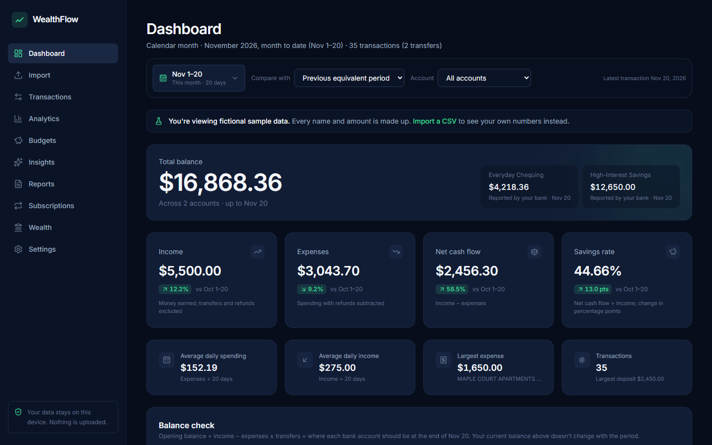
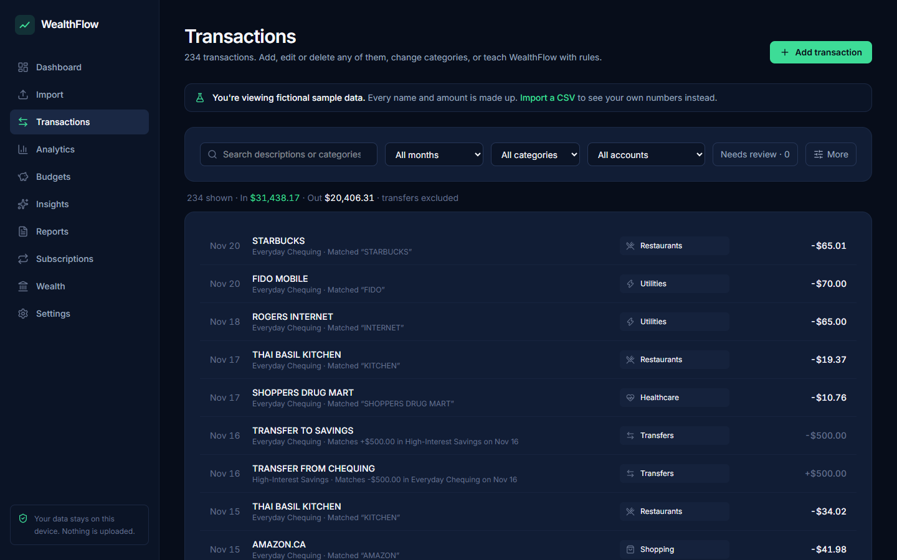
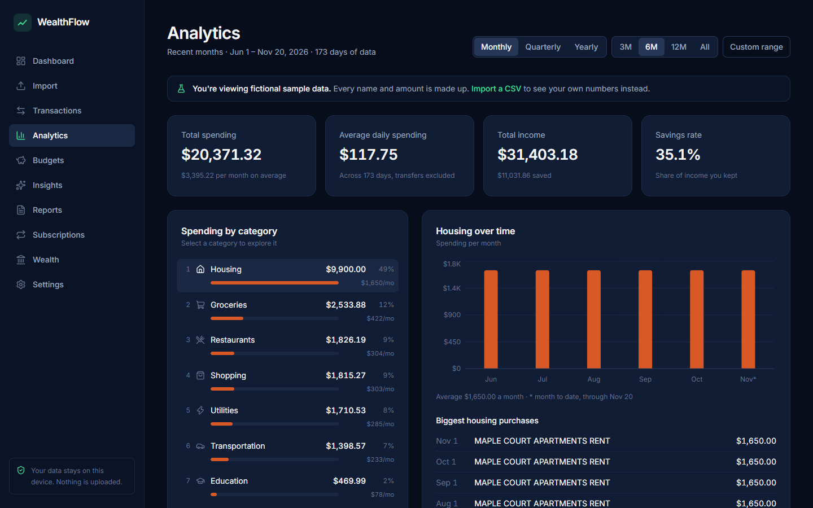
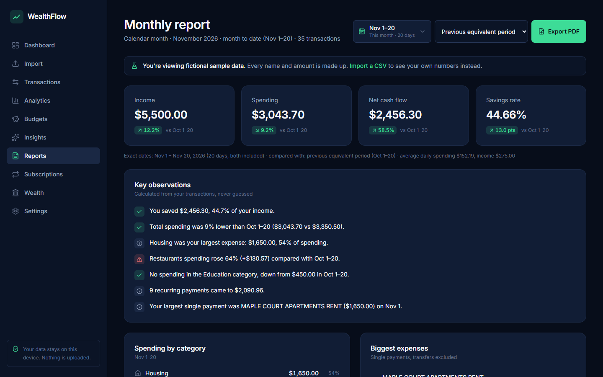
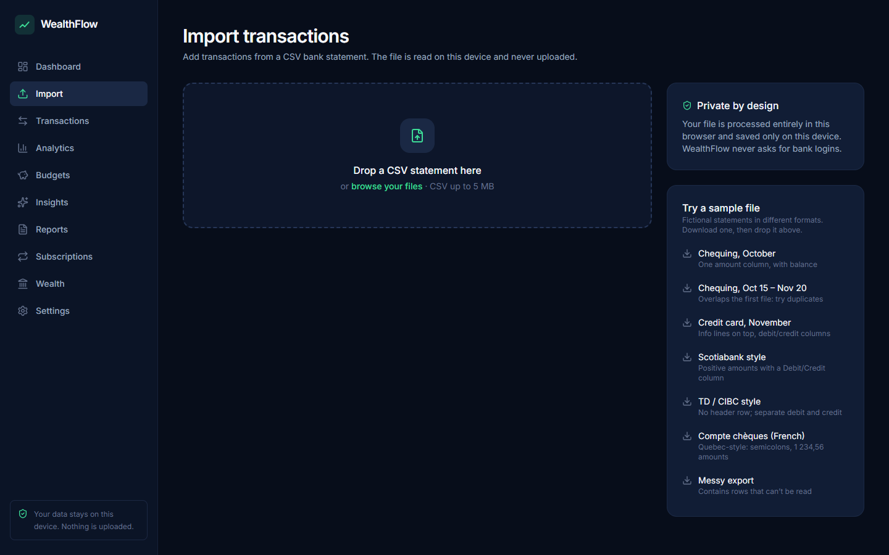
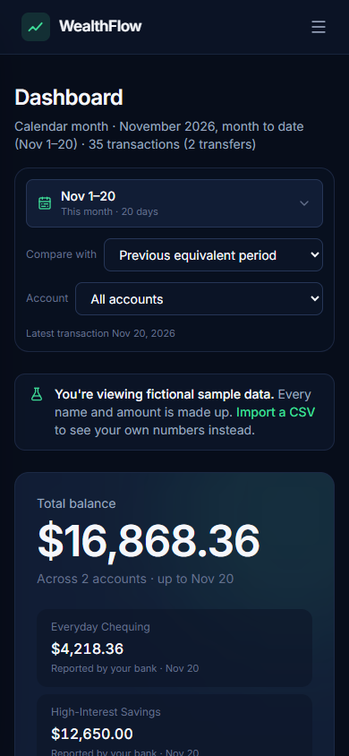

# WealthFlow

A personal finance analytics app for Canada. Import CSV bank statements and see where your money goes: spending by category, trends, monthly reports, subscriptions, net worth and plain-English insights. **All amounts are in Canadian dollars (CAD).**

**Everything runs in your browser.** Statements are read on your device, data is stored only in this browser (IndexedDB), and the production build's Content Security Policy blocks connections to any other server.

> ⚠️ This is a learning project and a prototype. Use the fictional sample data, not real financial information, until the security checklist at the bottom has been completed.



<details>
<summary>More screenshots</summary>

| | |
| --- | --- |
|  |  |
|  |  |



All screenshots show the built-in fictional sample data.
</details>

## Getting started

**Requirements:** [Node.js](https://nodejs.org) 20.19+ or 22.12+ (required by Vite 8), and npm.

```bash
git clone https://github.com/Rafay-92/Wealthflow-.git
cd Wealthflow-
npm install
npm run dev          # open http://localhost:5173
```

To build and serve the production version (with the Content Security Policy applied):

```bash
npm run build        # type-checks, then builds into dist/
npm run preview      # serves dist/ at http://localhost:4173
```

On Windows you can also double-click `Open WealthFlow.bat`, which builds the app and opens it at http://localhost:5173.

## Tech stack

React 19 · TypeScript (strict) · Vite 8 · Tailwind CSS 4 · Recharts · Zustand · Dexie (IndexedDB) · React Router · PapaParse · jsPDF · Vitest · Playwright · oxlint

## Features

| Page | What it does |
| --- | --- |
| **Dashboard** | **Date-range picker** (presets, any calendar month, or any start and end date across months, years and leap days; Apply/Reset), **comparison** with the previous equivalent period, previous month, previous year or none, and an **account filter**. The period is kept in the web address and shared with Analytics and Reports. **Live** current balances (never changed by a historical period), transaction count, average daily spending and income, largest expense, cash flow by day/week/month/year, account balance history, category changes, monthly income/expenses/net cash flow/savings rate vs last month, budget progress, a **balance check** per bank account (opening + income − expenses ± transfers = expected closing, compared with your statement), insights, trends, spending breakdown, recent transactions |
| **Import** | Statement summary before saving (exact date range, money in/out, account, running-balance column), a link to view exactly the statement's period, CSV upload with drag and drop, header detection, column mapping with live preview, English and French (Quebec) exports including `1 234,56 $` amounts, date-format ambiguity warnings, duplicate detection, review before saving, undo per import |
| **Transactions** | **Add, edit and delete** transactions; search; filter by month, date range, category, account, type (income/expense/refund/transfer) and merchant; sort by date or amount; change categories with an optional rule for the merchant's future transactions; "needs review" queue |
| **Budgets** | Monthly budget per category: budget, spent, remaining, % used, with a pace marker for the month so far |
| **Analytics** | Monthly, quarterly or yearly grouping; 3M/6M/12M/All ranges or a custom range (grouped by day or week too), spending by category with per-category trends, income vs expenses, savings rate, month-over-month comparison, largest purchases, average daily spending |
| **Insights** | Rule-based findings, each with "how this was calculated" |
| **Reports** | Monthly or custom-period report with observations and the balance check, exportable as a text-based PDF |
| **Subscriptions** | Detected monthly payments with monthly and yearly cost; confirm or dismiss each |
| **Wealth** | Manually tracked assets (incl. TFSA, RRSP, FHSA, RESP) and liabilities (incl. lines of credit), net worth over time |
| **Settings** | Data overview, JSON backup and validated restore, delete all data, privacy facts |

Until you import a statement, every page shows **fictional sample data**. Sample data is never saved and never mixed with your own.

## Commands

| Command | What it does |
| --- | --- |
| `npm install` | Install dependencies |
| `npm run dev` | Dev server at http://localhost:5173 |
| `npm test` | Run the unit tests once (496 tests) |
| `npm run test:watch` | Re-run tests on every save |
| `npm run test:e2e` | Build, then run the browser tests in Microsoft Edge (26 tests) |
| `npm run build` | Type-check and build for production (into `dist/`) |
| `npm run preview` | Serve the production build at http://localhost:4173 (restart it after each build) |
| `npm run lint` | Check for common mistakes |

The Import page links to fictional sample CSVs in [`public/sample-data/`](public/sample-data/) in five formats: chequing, an overlapping chequing export, a credit card, a French-language Quebec-style export, and a deliberately messy file.

## Architecture

```
src/
├── lib/            Pure logic, no React. Every financial calculation lives here and is unit-tested.
│   ├── money.ts        Money as integer cents (never floating-point dollars)
│   ├── dates.ts        Calendar dates as 'YYYY-MM-DD' strings (no timezone drift)
│   ├── csv/            Parse → detect header → map columns → normalise → find duplicates
│   ├── categorize/     Keyword rules, user rules, transfer detection
│   ├── analytics/      Summaries, periods, trends, comparisons
│   ├── recurring/      Recurring payments and subscriptions
│   ├── report/         Monthly report and PDF rendering
│   ├── insights/       Insight context + providers
│   └── wealth/         Net worth
├── data/           IndexedDB schema (Dexie) and the repository: the only code that touches storage
├── store/          Zustand store: mirrors the database for the UI
├── components/     Reusable UI pieces, grouped by feature
├── hooks/          React hooks (insights, the shared period selection)
└── pages/          One component per route (lazy-loaded)
```

Data flows one way: **lib → store → pages → components**. Pages only display what `lib` functions return, which is why almost every number on screen is covered by a test.

### Key decisions

- **Integer cents, in CAD.** `0.1 + 0.2 !== 0.3` in JavaScript, so all money is stored as integers. `parseAmountToCents` parses text directly, reads `CA$`/`C$`/`CAD` markers, and rejects ambiguous input such as `12,34` unless the file is set to the French number format (auto-detected).
- **Transfers are not spending.** Money moving between your own accounts is detected (matching pairs across accounts, plus wording from Canadian banks such as `TFR-TO`, `WWW TRF`, `MB-TRANSFER`, `VIREMENT`) and excluded from income and spending. Interac e-Transfers and other payments to people are never treated as transfers.
- **One source of truth.** Every total, chart, balance and budget is calculated from the saved transactions each time; none is stored. Adding, editing or deleting a transaction writes to IndexedDB, the store reloads, and every page recalculates. Only inputs are stored: transactions, budgets, opening balances.
- **Refunds, reversals and card payments.** A refund or reversal lowers spending in its category (or the category of the earlier purchase from the same merchant); it's never income. A reversed paycheque lowers income. An unrecognised credit on a credit card is treated as a card payment, and "VISA PAYMENT"-style debits from chequing are transfers, so purchases aren't counted twice.
- **Running balances are checkpoints, never transactions.** A statement's balance column becomes daily "bank-reported" balances in their own table. They give an exact opening and closing for any period inside the statement, and every one inside the period is compared with opening + transactions; a mismatch names the day. They're read from every row in the file (including skipped duplicates), and the right end-of-day row is found even when same-day rows are listed out of order.
- **Opening balances are labelled, never assumed.** A balance you type is stored as "what the account held at the start of a date" (a period's closing is the start of the next day). Every opening is shown as **User-provided** (typed for that date), **Bank-reported** (the statement's balance for that date), **Inferred from a reported closing balance** (the bank's balance minus the transactions in between), **Estimated** (carried from a balance you typed for another date) or **Unknown**. Only an actual opening (user-provided or bank-reported) can produce a verified "Balanced"; with an inferred one the expected closing matches the bank by construction, so the check says it can't be verified.
- **Calendar month vs custom period.** A month is compared with the month before; a custom period with the same number of days just before it. Both use the same calculations. Budgets, insights and recurring payments are per calendar month, so they're shown in month view only.
- **Live balances.** Each account's balance starts from a known figure (the bank's reported balance or an opening balance you entered, whichever is most recent) plus every transaction after it. Opening balances are never income.
- **Duplicate protection survives edits.** Editing an imported transaction freezes the bank's original values, and deleting one leaves a small record, so re-importing an overlapping statement doesn't duplicate or resurrect it. Undoing the import clears those records.
- **Fair comparisons.** A partial month (or quarter, or year) is compared with the same number of days of the previous one (Nov 1–20 vs Oct 1–20).
- **Categorization priority:** your manual choice → your rules → e-transfers → transfer pairs → transfer wording → refunds/reversals → built-in merchant keywords (longest match wins) → fallback marked "needs review".
- **Schema migrations.** The database is at version 8. Each stage added a version rather than editing an old one, and a test upgrades a version-1 database without losing data.
- **Insights are AI-ready but rule-based.** `buildInsightContext` produces aggregated numbers only; an `InsightProvider` turns them into insights. An AI provider could implement the same interface, receiving the summary, never raw statements, and only with the user's opt-in.

## Testing

- **Unit tests** (Vitest): `npm test`. These cover money parsing, dates, CSV parsing (including the real sample files), duplicates, categorization, analytics, recurring detection, reports and PDF content, insights, net worth, backups and database migrations.
- **Browser tests** (Playwright, in [`e2e/`](e2e/)): `npm run test:e2e`. These build the app, start a fresh production server, and use your installed Microsoft Edge, so no browser download is needed. They cover every page, English and French imports with duplicates, transfers and totals, rules, PDF export, wealth, backup and restore, phone widths and keyboard access. **Any console error, crash or Content Security Policy violation fails the test automatically.** On macOS or Linux without Edge, change `channel: 'msedge'` in [`playwright.config.ts`](playwright.config.ts) to `'chrome'`, or remove it and run `npx playwright install chromium`.
- **Before a pull request:** `npm run lint && npm test && npm run build && npm run test:e2e`.

## Your data and privacy

- **Where it's stored:** in your browser's IndexedDB (database name `wealthflow`), on this device and in this browser profile only. There is no server, account or cloud database.
- **What leaves your device:** nothing, unless you choose to download a backup (JSON) or a PDF report. The app makes no network requests of its own, and the production build's Content Security Policy (`connect-src 'self'`) stops the page from contacting other servers.
- **Not encrypted:** the data in IndexedDB and in backup files is plain text. Anyone with access to this browser profile, or to a backup file, can read it.
- **Deleting it:** Settings → Delete all data erases every table. Clearing the site's data in your browser does the same.
- **Never commit your own data.** `.gitignore` excludes CSV/OFX/QFX/QIF files (except the fictional samples), `.env` files and WealthFlow's backup and report files, but check `git status` before committing.

## Known limitations

- **CSV only.** PDF statements aren't supported. Ambiguous dates (MM/DD vs DD/MM, common in Canadian exports) default to MM/DD and are flagged for you to check.
- **CAD only.** No multi-currency accounts or conversion.
- **Subscriptions** must recur monthly. Weekly and yearly charges aren't detected.
- **Wealth values are entered by hand.** There are no investment price feeds.
- **One browser, one device.** Clearing site data deletes everything (keep a backup), and there's no sync.
- **Heuristics can be wrong.** Categories, transfers and recurring payments are detected by rules. Everything can be corrected by hand, and the "needs review" filter shows what nothing matched.

## License

WealthFlow is released under the [MIT License](LICENSE). © 2026 Rafay-92.

In plain terms:

- **You may** use, copy, modify, merge, publish, distribute, sublicense and sell copies of this code, in personal or commercial projects, open or closed source.
- **You must** keep the copyright notice and the license text in all copies or substantial portions of the code.
- **There is no warranty.** The software is provided "as is", and the authors are not liable for any damages arising from its use. That includes financial decisions made using its calculations: always check figures against your bank's own statements.

## Before using real financial data

The prototype keeps data local, but more is needed before real statements should go in it:

1. **Data at rest is not encrypted.** Anyone with access to this browser profile can read it. Consider encrypting IndexedDB contents with a user passphrase (Web Crypto).
2. **Deliver the CSP as an HTTP header** (it's currently a `<meta>` tag), and add `frame-ancestors 'none'`, HTTPS-only hosting and HSTS.
3. **Supply chain:** keep `npm audit` clean, pin dependency versions, and review updates.
4. **A security review** of the import path (untrusted CSV input), the PDF generation and the backup file handling. Backups are already validated before restoring, and restoring is all-or-nothing.
5. **Backups contain plain-text financial data.** Users need clear guidance, or the backups should be encrypted.
